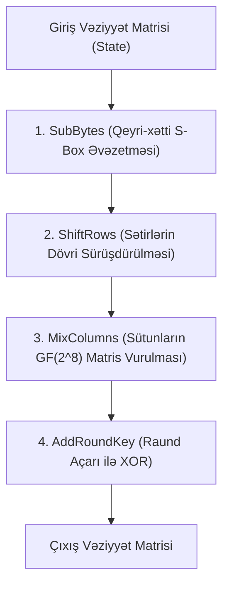

# AES Alqoritmi (Advanced Encryption Standard / Rijndael)

**AES (Advanced Encryption Standard)** — 2001-ci ildə NIST tərəfindən DES-in əvəzinə qlobal standart kimi qəbul edilmiş, Belçika kriptoqrafları [[Joan Daemen və Vincent Rijmen]] tərəfindən yaradılmış simmetrik blok şifrəsidir.

---

## 📐 Parametrlər və Daxili Vəziyyət

- **Blok Ölçüsü:** 128 bit (16 bayt). Daxildə $4 \times 4$ baytlıq vəziyyət matrisi (State Matrix) kimi saxlanılır.
- **Açar Uzunluqları və Raund Sayı:**
  - **AES-128:** 128-bit açar $\to$ 10 raund
  - **AES-192:** 192-bit açar $\to$ 12 raund
  - **AES-256:** 256-bit açar $\to$ 14 raund

---

## ⚙️ SPN Raund Çevrilmələri (4 Əsas Addım)

Hər bir raund (sonuncu raund istisna olmaqla) dörd addımdan ibarətdir:

1. **SubBytes (Konfuziya):** Hər bir bayt [[Qalua Meydanları GF(2^8)|GF(2^8)]] cəbri sahəsində multiplikativ inversiya ($x \mapsto x^{-1}$) və affin çevrilmə vasitəsilə qeyri-xətti olaraq əvəz edilir. Diferensial və xətti kriptoanalizə qarşı ən güclü müdafiə qatıdır.
2. **ShiftRows (Diffuziya):** 0-cı sətir sürüşdürülmür, 1-ci sətir 1 bayt sola, 2-ci sətir 2 bayt sola, 3-cü sətir 3 bayt sola dövri sürüşdürülür.
3. **MixColumns (Diffuziya):** Hər bir $4 \times 1$ sütun vektoru $GF(2^8)$ sahəsi üzərində xüsusi $4 \times 4$ MDS matrisinə vurulur (Maksimum Distansiya Ayrılması). 2 raunddan sonra 1 bitlik dəyişiklik bütün 128 bitə yayılır (Avalanche effect).
4. **AddRoundKey:** Vəziyyət matrisinin hər bir baytı `KeyExpansion` alqoritmi ilə törədilmiş 128-bitlik raund açarı ilə bit səviyyəsində XOR edilir.

*(Qeyd: Sonuncu raundda `MixColumns` addımı atlanır).*

---

## 🛡️ Təhlükəsizlik və Performans

- 20 ildən artıq intensiv kriptoanalizə baxmayaraq, tam raundlu AES-ə qarşı heç bir praktik praktiki analitik hücum tapılmamışdır.
- Müasir CPU-larda (Intel/AMD AES-NI, ARMv8 Cryptography Extensions) AES əməliyyatları hardware təlimatları səviyyəsində icra edilir (1 bayt üçün 1 CPU dövründən az sürət).

---

## 🔗 Əlaqəli Səhifələr

- [[Qalua Meydanları GF(2^8)]]
- [[Blok Şifrə Rejimləri (ECB, CBC, CTR, GCM)]]
- [[Feystel Şəbəkələri və DES]]
- [[Claude Shannon]]
- [[Joan Daemen və Vincent Rijmen]]
