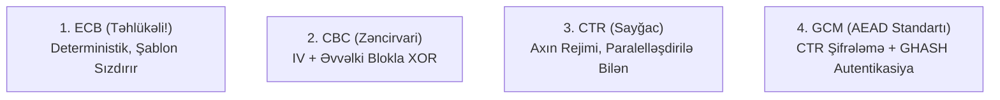

# Blok Şifrə Rejimləri (ECB, CBC, CTR, GCM)

Blok şifrəsi (məsələn, [[AES Alqoritmi (Rijndael)|AES]]) sabit ölçülü (128 bit) tək bir bloku şifrələyir. İxtiyari uzunluqlu məlumatları şifrələmək üçün **İş Rejimləri (Modes of Operation)** istifadə olunur.

---

## 📊 4 Əsas Rejimin Müqayisəsi

### 1. ECB (Electronic Codebook) — ❌ QƏTİ QADAĞANDIR

- Hər blok eyni açarla müstəqil şifrələnir: $C_i = E_K(P_i)$.
- **Zəiflik:** Eyni açıq mətn blokları həmişə eyni şifrəli blokları verir. Şifrələnmiş şəkildə belə məlumatın strukturu (şəkillər, verilənlər bazası cədvəlləri) aydın görünür.

---

### 🐧 Vizual Nümayiş: "AES Pinqvini" Effekti (ECB vs CBC)

![[aes_penguin.png]]

- **1. Orijinal Açıq Mətn:** Linux maskotu Tux pinqvini təsviri.
- **2. ECB Rejimində Şifrələmə (Naxış Sızıntısı):** Eyni açıq mətn blokları eyni şifrəli blokları verdiyi üçün şəklin daxili statistik naxışları gizlənmir və pinqvinin forması aydın tanınır.
- **3. CBC Rejimində Şifrələmə (Təhlükəsiz Randomizasiya):** Zəncirləmə ($C_i = E_K(P_i \oplus C_{i-1})$) və Başlanğıc Vektoru ($IV$) sayəsində açıq mətn strukturu tamamilə maskalanır və təsadüfi küy (pseudorandom noise) əldə edilir.

---

### 2. CBC (Cipher Block Chaining)

- Hər açıq blok şifrələnməzdən əvvəl əvvəlki şifrəli blokla XOR edilir:
  $$C_0 = \text{IV}, \quad C_i = E_K(P_i \oplus C_{i-1})$$
- **Xüsusiyyətlər:** Təsadüfi İlkinləşdirmə Vektoru (IV) tələb edir. Şifrləmə ardıcıldır (paralelləşdirilə bilməz), deşifrləmə paralelləşdirilə bilər. Padding Oracle hücumlarına qarşı həssas ola bilər.

### 3. CTR (Counter Mode)

- Blok şifrəsini yüksək sürətli **axın şifrəsinə** çevirir:
  $$C_i = P_i \oplus E_K(\text{Nonce} \mathbin{\Vert} i)$$
- **Üstünlüklər:** Həm şifrləmə, həm deşifrləmə tamamilə paralelləşdirilə bilir. Məlumatın təsadüfi hissəsinə birbaşa oxuma/yazma (random access) imkanı verir. Padding tələb etmir.
- **Kritik Qayda:** Eyni $(\text{Nonce}, K)$ cütü heç vaxt iki fərqli məlumat üçün təkrar istifadə edilməməlidir (Two-Time Pad fəlakəti).

### 4. GCM (Galois/Counter Mode) — 🌟 MÜASİR AEAD STANDARTI

- **Authenticated Encryption with Associated Data (AEAD):** Həm konfidensiallığı, həm də tamlıq və autentikasiyanı eyni vaxtda təmin edir.
- **Quruluş:** CTR rejimində şifrələmə + $GF(2^{128})$ Qalua sahəsi üzərində universal GHASH autentikasiya teqi.
- TLS 1.3 və IPsec-də ən çox istifadə olunan standartdır.

---

## 🔗 Əlaqəli Səhifələr

- [[AES Alqoritmi (Rijndael)]]
- [[Poly1305 və AEAD]]
- [[Kriptoqrafik Təhlükəsizlik Xidmətləri]]
- [[TLS 1.3 Protokolu]]
