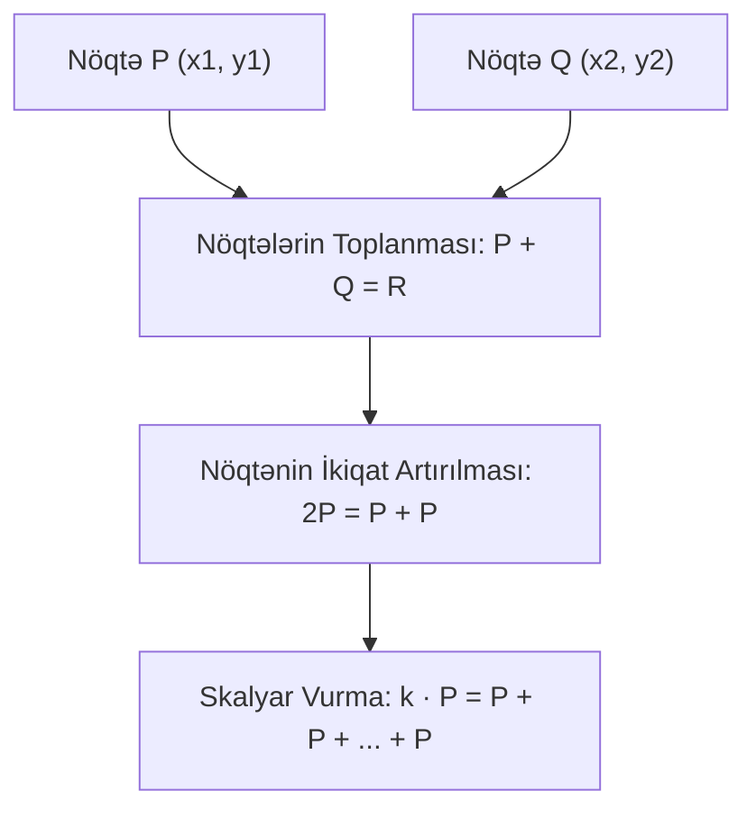

# Elliptik Əyrilər Kriptoqrafiyası (ECC)

**Elliptik Əyrilər Kriptoqrafiyası (ECC)** — 1985-ci ildə [[Neal Koblitz və Victor Miller]] tərəfindən müstəqil olaraq irəli sürülmüş və sonlu meydanlar üzərindəki elliptik əyrilərin cəbri qrup strukturuna əsaslanan müasir asimmetrik kriptoqrafiya paradiqmasıdır.

---

## 📐 Riyazi Tənlik və Qrup Qaydaları

Sadə $p > 3$ modulu üzərində qısa **Weierstrass forması**:

$$y^2 \equiv x^3 + ax + b \pmod p$$
(Ayrı-ayrı köklərin olması üçün diskriminant şərti: $4a^3 + 27b^2 \not\equiv 0 \pmod p$)

### 1. Nöqtələrin Toplanması (Point Addition - $P \ne Q$):

İki nöqtədən keçən düz xətt əyrini üçüncü $R'$ nöqtəsində kəsir. Onun $x$-oxuna nəzərən simmetriyası cəm nöqtəsidir: $R = P + Q$.
$$\lambda = \frac{y_2 - y_1}{x_2 - x_1} \bmod p$$
$$x_3 = \lambda^2 - x_1 - x_2 \bmod p, \quad y_3 = \lambda(x_1 - x_3) - y_1 \bmod p$$

### 2. Nöqtənin İkiqat Artırılması (Point Doubling - $P = Q$):

Nöqtədən toxunan çəkilir: $\lambda = \frac{3x_1^2 + a}{2y_1} \bmod p$.

### 3. Sonsuzluqdakı Nöqtə ($\mathcal{O}$):

Qrupun neytral (sıfır) elementidir: $P + \mathcal{O} = P$.

---

## 🔒 ECDLP və Açar Effektivliyi

- **ECDLP (Elliptic Curve Discrete Logarithm Problem):** Verilmiş baza nöqtəsi $G$ və $Q = k \cdot G$ üçün $k$ tam ədədini tapmaq məlum sub-eksponensial indeks-hesablama hücumlarına qarşı qapalıdır ($O(\sqrt{n})$ mürəkkəblik).
- **Açar Ölçüsü Üstünlüyü:**

| Təhlükəsizlik Səviyyəsi | RSA Açar Ölçüsü | ECC Açar Ölçüsü | Nisbət |
| :---: | :---: | :---: | :---: |
| 112 bit | 2048 bit | **224 bit** | ~ 9:1 |
| **128 bit (Standart)** | 3072 bit | **256 bit (secp256k1 / Curve25519)** | **~ 12:1** |
| 256 bit (Hərbi) | 15360 bit | **512 bit** | ~ 30:1 |

---

## 🔗 Əlaqəli Səhifələr

- [[Rəqəmsal İmzalar və ECDSA]]
- [[Diffie-Hellman Açar Mübadiləsi]]
- [[Bitcoin]]
- [[Signal Protocol]]
- [[Neal Koblitz və Victor Miller]]
