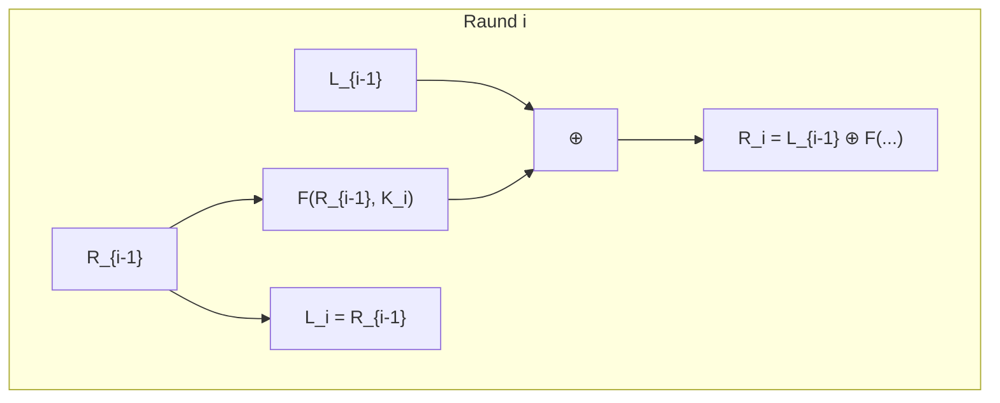

# Feystel Şəbəkələri və DES (Data Encryption Standard)

**Feystel şəbəkəsi (Feistel Network)** — Horst Feistel (IBM) tərəfindən 1970-ci illərdə işlənib hazırlanmış və blok şifrələrinin qurulmasında ən geniş yayılmış simmetrik arxitekturalardan biridir.

---

## ⚙️ Feystel Strukturunun Riyazi Sxemi

Giriş bloku iki bərabər hissəyə ($L_{i-1}, R_{i-1}$) bölünür. $i$-ci raundda aşağıdakı çevrilmə tətbiq olunur:

$$L_i = R_{i-1}$$
$$R_i = L_{i-1} \oplus F(R_{i-1}, K_i)$$

### 💎 Fundamental Üstünlüyü:

$F$ raund funksiyasının **tərsi (inversiyası) olmasa belə**, deşifrləmə eyni aparatla həyata keçirilir — sadəcə raund açarları tərs ardıcıllıqla ($K_{16}, K_{15}, \dots, K_1$) daxil edilir.

---

## 🏛️ DES (Data Encryption Standard)

- **Standartlaşma:** 1977-ci ildə NIST/NBS tərəfindən qəbul edilmişdir.
- **Parametrlər:** 64-bit blok, 64-bit ilkin açar (8 paritet biti çıxıldıqdan sonra cəmi **56 effektiv açar biti**), 16 Feystel raundu.
- **Tarixi Zəiflik:** 56-bitlik açar fəzası ($2^{56} \approx 7.2 \times 10^{16}$) kompüterlərin inkişafı ilə kiçik qaldı və 1998-ci ildə EFF Deep Crack tərəfindən bir neçə günə brute-force ilə sındırıldı.
- **Triple-DES (3DES):** Təhlükəsizliyi artırmaq üçün $C = E_{K1}(D_{K2}(E_{K1}(P)))$ sxemi tətbiq edildi ($2 \times 56 = 112$ bit effektiv təhlükəsizlik), sonradan [[AES Alqoritmi (Rijndael)|AES]] ilə əvəz olundu.

---

## 🔗 Əlaqəli Səhifələr

- [[AES Alqoritmi (Rijndael)]]
- [[Blok Şifrə Rejimləri (ECB, CBC, CTR, GCM)]]
- [[Claude Shannon]]
