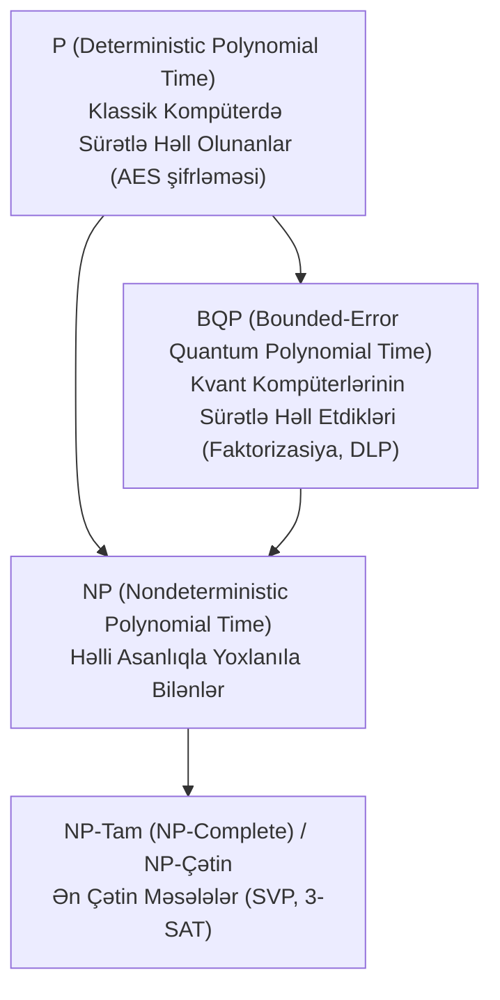

# Hesablama Mürəkkəbliyi (P vs NP vs BQP)

Kriptoqrafiyanın bütün müasir asimmetrik və simmetrik təhlükəsizlik isbatları **Hesablama Mürəkkəbliyi Nəzəriyyəsinə (Complexity Theory)** və çətinlik siniflərinə əsaslanır.

---

## 🏛️ Əsas Mürəkkəblik Sinifləri

- **P:** Deterministik Tyurinq maşınında $O(n^k)$ polinomial zamanda həll edilən məsələlər (məs. şifrələmə, modulyar vurma, cütlük yoxlanışı).
- **NP:** Həll verildikdə onun doğruluğu polinomial zamanda yoxlanıla bilən məsələlər (məs. Faktorizasiya, Qəfəs məsələləri).
- **BQP:** Kvant kompüterlərinin polinomial zamanda həll edə bildiyi məsələlər. **Şor alqoritmi sübut etdi ki, Faktorizasiya və DLP məsələləri BQP sinfinə daxildir!**
- **NP-Tam / NP-Çətin:** Kvant kompüterlərinin belə sürətlə həll edə bilmədiyi güman edilən həndəsi qəfəs (SVP) və kod əsaslı məsələlər ([[Post-Kvant Kriptoqrafiya (PQC)|PQC-nin]] əsası).

---

## 🔗 Əlaqəli Səhifələr

- [[Post-Kvant Kriptoqrafiya (PQC)]]
- [[Qəfəs Əsaslı Kriptoqrafiya (Lattice-based & Kyber)]]
- [[Peter Shor]]
- [[RSA Kriptosistemi]]
