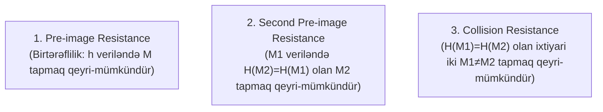

# Kriptoqrafik Heş Funksiyaları (Cryptographic Hash Functions)

**Kriptoqrafik heş funksiyası** — ixtiyari uzunluqlu giriş məlumatını ($M \in \{0, 1\}^*$) qəbul edən və onu deterministik şəkildə sabit uzunluqlu çıxış bit ardıcıllığına ($h = H(M) \in \{0, 1\}^n$) çevirən birtərəfli riyazi funksiyadır.

Məsələn, SHA-256 funksiyası üçün çıxış həmişə dəqiq 256 bitdir (64 onaltılıq simvol).

---

## 🛡️ Heş Funksiyalarının 3 Əsas Təhlükəsizlik Xüsusiyyəti

### 1. İlkin Təsvirə Qarşı Davamlılıq (Pre-image Resistance / One-Way):

Verilmiş $h$ heş dəyəri üçün $H(M) = h$ şərtini ödəyən ilkin $M$ məlumatını tapmaq hesablama baxımından qeyri-mümkün olmalıdır ($O(2^n)$ mürəkkəblik).

### 2. İkinci İlkin Təsvirə Qarşı Davamlılıq (Second Pre-image Resistance / Weak Collision Resistance):

Məlum $M_1$ məlumatı verildikdə, $M_2 \ne M_1$ və $H(M_2) = H(M_1)$ şərtini ödəyən başqa bir $M_2$ məlumatını tapmaq qeyri-mümkün olmalıdır ($O(2^n)$ mürəkkəblik).

### 3. Toqquşmaya Qarşı Davamlılıq (Collision Resistance / Strong Collision Resistance):

$H(M_1) = H(M_2)$ şərtini ödəyən hər hansı iki fərqli $M_1 \ne M_2$ məlumat cütünü tapmaq qeyri-mümkün olmalıdır.
*(Doğum günü paradoksu (Birthday Paradox) səbəbindən toqquşma axtarışının mürəkkəbliyi $O(2^{n/2})$-dir; buna görə 128-bitlik MD5 artıq etibarsızdır, minimum 256-bitlik SHA-256 tövsiyə olunur).*

---

## 🌊 Uçqun Effekti (Avalanche Effect)

Girişdəki cəmi **1 bitlik dəyişiklik** (məsələn, bir hərfin böyük/kiçik yazılması və ya bir nöqtə əlavəsi) çıxışdakı heş bitlərinin ən azı 50%-nin kəskin və təsadüfi şəkildə dəyişməsinə səbəb olur.

---

## 🚀 Əsas Tətbiq Sahələri

- **Məlumat Tamlığının Təsdiqi:** [[Kriptoqrafik Təhlükəsizlik Xidmətləri|Tamlıq]] xidməti, fayl yükləmə checksum yoxlamaları.
- **Rəqəmsal İmzalar:** Böyük sənədin özü deyil, sürət üçün onun kiçik heşi imzalanır.
- **Blokçeyn və Kriptovalyutalar:** [[Bitcoin]] zəncirləri, Merkle Ağacları və Proof of Work (PoW) tapmacaları.
- **Parol Saxlanması:** Parollar verilənlər bazasında açıq deyil, duzlanmış (salted) heş kimi (Argon2, bcrypt, PBKDF2) saxlanılır.

---

## 🔗 Əlaqəli Səhifələr

- [[Kriptoqrafik Təhlükəsizlik Xidmətləri]]
- [[Bitcoin]]
- [[Claude Shannon]]
- [[Simmetrik və Asimmetrik Kriptoqrafiya]]
