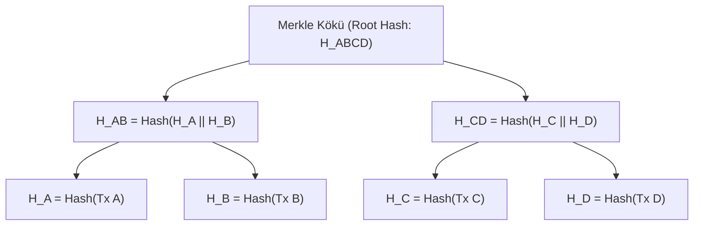

# Merkle Ağacları (Merkle Trees / Hash Trees)

**Merkle ağacı** — 1979-cu ildə Ralf Merkl (Ralph Merkle) tərəfindən patentləşdirilmiş, böyük verilənlər çoxluqlarının bütövlüyünü və tərkibini səmərəli və təhlükəsiz şəkildə yoxlamağa imkan verən ikili (binary) heş ağacı strukturudur.

---

## 🌲 Quruluşu və Arxitekturası

- **Yarpaq düyünləri (Leaves):** Hər bir fərdi məlumat blokunun (məsələn, tranzaksiyanın) kriptoqrafik heşidir ($H_A, H_B, \dots$).
- **Daxili düyünlər (Branch Nodes):** İki alt düyünün heşlərinin birləşdirilməsindən (konkatenasiya) alınan heş dəyəridir ($H_{AB} = \text{Hash}(H_A \mathbin{\Vert} H_B)$).
- **Merkle Kökü (Merkle Root):** Ağacın ən təpəsindəki tək heş dəyəri. Bütün tranzaksiyaların bütövlüyünü yeganə 32-baytlıq heşlə təmsil edir.

---

## ⚡ Loqarifmik Sübut Mürəkkəbliyi ($O(\log N)$)

Əgər blokda $N = 1,000,000$ tranzaksiya varsa, konkret bir tranzaksiyanın blokda mövcud olduğunu (Membership Proof) yoxlamaq üçün bütün tranzaksiyaları yükləməyə ehtiyac yoxdur:
- Yalnız ağacın həmin budağındakı qardaş heşlər (**Merkle Proof / Audit Trail**) lazımdır.
- Yoxlama addımlarının sayı cəmi: $\log_2(1,000,000) \approx 20$ heş hesablamasıdır!
- Bu xüsusiyyət yüngül müştərilərin (**SPV - Simplified Payment Verification**) mobil cihazlarda tam bloku yükləmədən işləməsini təmin edir.

---

## 🔗 Əlaqəli Səhifələr

- [[Kriptoqrafik Heş Funksiyaları]]
- [[Bitcoin]]
- [[Kriptoqrafik Təhlükəsizlik Xidmətləri]]
