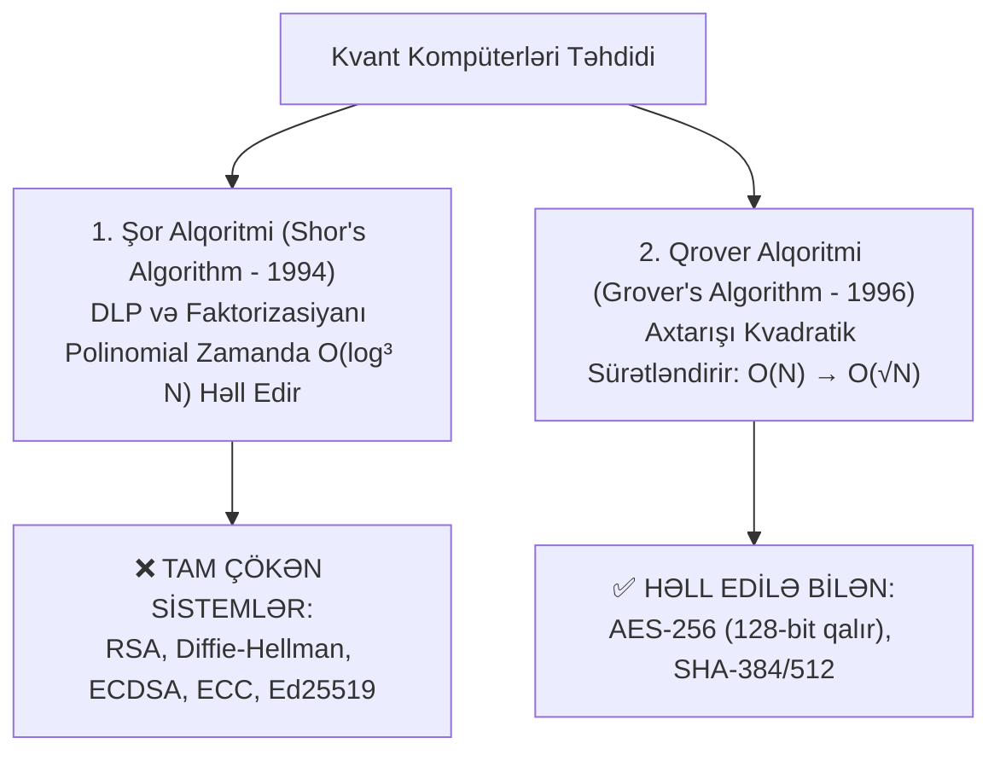

# Post-Kvant Kriptoqrafiya (Post-Quantum Cryptography - PQC)

**Post-Kvant Kriptoqrafiya (PQC)** — gələcəkdə genişmiqyaslı kvant kompüterlərinin (Cryptanalytically Relevant Quantum Computer - CRQC) yaradılması zamanı mövcud asimmetrik sistemlərin çökməsinin qarşısını almaq üçün hazırlanmış və **həm klassik, həm də kvant kompüterləri üçün sındırılması qeyri-mümkün olan** yeni nəsil kriptoqrafik alqoritmlərdir.

---

## ⚡ Kvant Kompüterlərinin Təhdidi

---

## 🏛️ NIST PQC Standartları (2024–2025)

NIST-in çoxillik qlobal seçimindən sonra aşağıdakı standartlar rəsmiləşdirilmişdir:

1. **Açar İdarəetməsi və KEM (Key Encapsulation):**
   - **ML-KEM (CRYSTALS-Kyber):** [[Qəfəs Əsaslı Kriptoqrafiya (Lattice-based & Kyber)|Qəfəs əsaslı (Module-LWE)]] üsul. Əsas standartdır.
2. **Rəqəmsal İmzalar:**
   - **ML-DSA (CRYSTALS-Dilithium):** Qəfəs əsaslı ümumi məqsədli imza.
   - **FN-DSA (Falcon):** Kiçik imza ölçülü qəfəs imzası.
   - **SLH-DSA (SPHINCS+):** Dövlətsiz heş əsaslı etibarlı ehtiyat imza.

---

## 🔗 Əlaqəli Səhifələr

- [[Qəfəs Əsaslı Kriptoqrafiya (Lattice-based & Kyber)]]
- [[RSA Kriptosistemi]]
- [[Elliptik Əyrilər Kriptoqrafiyası (ECC)]]
- [[Peter Shor]]
- [[Hesablama Mürəkkəbliyi (P vs NP vs BQP)]]
