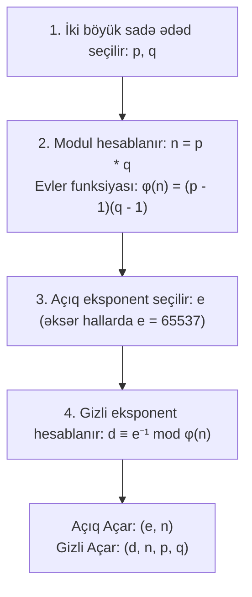

# RSA Kriptosistemi (Rivest-Shamir-Adleman)

**RSA** — 1977-ci ildə [[Ron Rivest, Adi Shamir və Leonard Adleman (RSA)|Ron Rivest, Adi Shamir və Leonard Adleman]] (MIT) tərəfindən ixtira edilmiş dünyanın ilk praktik və ən məşhur asimmetrik (açıq açarlı) şifrələmə və rəqəmsal imza alqoritmidir.

---

## 📐 Riyazi Alqoritm və Açar Qurulması

### Şifrləmə və Deşifrləmə:

- **Şifrləmə:** $c = m^e \bmod n$
- **Deşifrləmə:** $m = c^d \bmod n$
- **Riyazi Doğruluq:** [[Evler Teoremi və Fermat-ın Kiçik Teoremi|Evler teoreminə]] görə $m^{ed} = m^{k\phi(n)+1} \equiv m \pmod n$.

---

## 🛡️ Təhlükəsizlik və Praktiki Tətbiq (OAEP Padding)

- **Faktorizasiya Problemi:** RSA-nın təhlükəsizliyi $n$ ədədinin $p$ və $q$ sadə vuruqlarına ayrılmasının (Integer Factorization) klassik kompüterlər üçün çətinliyinə əsaslanır.
- **Tövsiyə olunan Açar Ölçüsü:** Minimum **2048 bit**, tövsiyə olunan **3072 bit** və ya **4096 bit**.
- **Sadə RSA Zəifliyi və OAEP:** Təmiz (textbook) RSA qeyri-təhlükəsizdir (multiplikativ homomorfizm və deterministiklik səbəbilə). Praktikada mütləq **RSA-OAEP (Optimal Asymmetric Encryption Padding)** və ya **RSA-PSS** imza padding-i tətbiq olunmalıdır.

---

## 🔗 Əlaqəli Səhifələr

- [[Evler Teoremi və Fermat-ın Kiçik Teoremi]]
- [[Çin Qalıq Teoremi (CRT)]]
- [[Genişləndirilmiş Evklid Alqoritmi]]
- [[Simmetrik və Asimmetrik Kriptoqrafiya]]
- [[Ron Rivest, Adi Shamir və Leonard Adleman (RSA)]]
- [[Post-Kvant Kriptoqrafiya (PQC)]]
