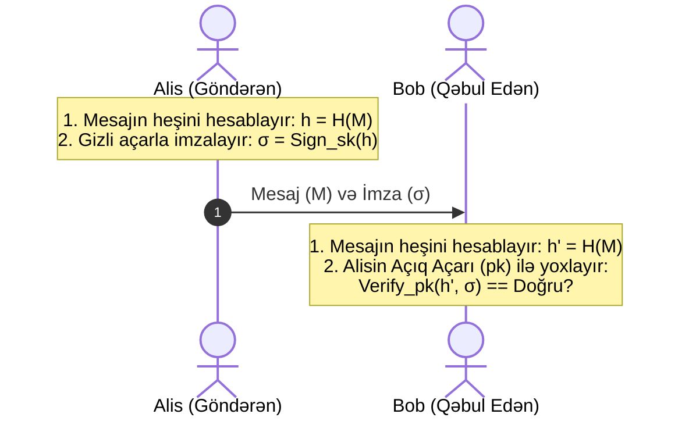

# Rəqəmsal İmzalar və ECDSA (Digital Signatures & ECDSA)

**Rəqəmsal imza** — rəqəmsal sənədlərin və ya tranzaksiyaların həqiqiliyini, mənbəyini və bütövlüyünü təsdiq edən riyazi sxemdir. O, adi əl yazısı imzasının rəqəmsal analoqudur, lakin ondan fərqli olaraq sənədin hər bir biti ilə sıx riyazi əlaqədədir və saxtalaşdırıla bilməz.

---

## 🛡️ Təmin Etdiyi 3 Əsas Xidmət

Bax: [[Kriptoqrafik Təhlükəsizlik Xidmətləri]]
1. **Autentikasiya (Mənbə Təsdiqi):** İmza yalnız göndərənin gizli açarı ilə yaradıla bilər.
2. **Tamlıq (Integrity):** Əgər sənəddə 1 bit belə dəyişərsə, imza doğrulaması uğursuz olur.
3. **İnkar Edilməzlik (Non-repudiation):** Göndərən sənədi imzalamadığını iddia edə bilməz.

---

## ⚙️ İmzalanma və Doğrulama Arxitekturası

---

## ⚡ ECDSA (Elliptic Curve Digital Signature Algorithm)

ECDSA elliptik əyrilər qrupu ($\mathbb{F}_p$ üzərində $y^2 = x^3 + ax + b$) üzərində diskret loqarifm probleminə əsaslanan rəqəmsal imza alqoritmidir.

- **Üstünlüyü:** RSA ilə müqayisədə eyni təhlükəsizlik səviyyəsini (128-bit) RSA 3072-bitlik açarlarla təmin etdiyi halda, ECDSA cəmi **256-bitlik** açarla təmin edir.
- **Tətbiq:** [[Bitcoin]] və Ethereum şəbəkələrində tranzaksiyaların imzalanması üçün **secp256k1** Koblitz əyrisindən istifadə olunur.

---

## 🔗 Əlaqəli Səhifələr

- [[Kriptoqrafik Təhlükəsizlik Xidmətləri]]
- [[Simmetrik və Asimmetrik Kriptoqrafiya]]
- [[Kriptoqrafik Heş Funksiyaları]]
- [[Bitcoin]]
- [[PGP və S-MIME]]
