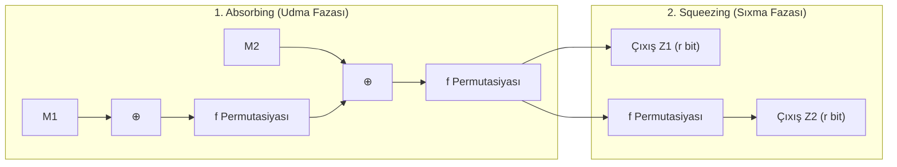

# Süngər Konstruksiyası və Keccak (SHA-3)

**SHA-3 (Secure Hash Algorithm 3)** — 2015-ci ildə NIST tərəfindən qəbul edilmiş və Guido Bertoni, Joan Daemen, Michaël Peeters və Gilles Van Assche tərəfindən hazırlanmış **Keccak** alqoritminə əsaslanan ən müasir heş standartıdır.

---

## 🧽 Süngər (Sponge) Konstruksiyasının İş Mexanizmi

Köhnə Merkle-Damgård konstruksiyalarından (MD5, SHA-1, SHA-2) fərqli olaraq, SHA-3 süngər prinsipindən istifadə edir:

- **Daxili Vəziyyət (State):** $b = r + c = 1600\text{ bit}$ ($5 \times 5 \times 64$ bitlik 3D massiv).
  - **$r$ (Bitrate / Sürət):** Giriş məlumatının daxil edildiyi və çıxışın oxunduğu aktiv sahə.
  - **$c$ (Capacity / Tutum):** Təhlükəsizlik baryeri. Heç vaxt birbaşa oxunmur və ya yazılmır. Toqquşma təhlükəsizliyi $2^{c/2}$-dir.

---

## 🛡️ SHA-2-dən Üstünlükləri

1. **Uzunluq Genişləndirmə Hücumlarına (Length Extension Attack) Qarşı Tam Təbii İmmunitet:** $c$ biti gizli qaldığından $H(M \mathbin{\Vert} \text{suffix})$ heşini açarsız hesablamaq qeyri-mümkündür.
2. **Dəyişən Çıxış Uzunluğu (XOF - Extendable-Output Functions):** SHAKE128 və SHAKE256 ilə istənilən bayt uzunluğunda (məsələn, 1000 bayt) təsadüfi axın generasiya etmək mümkündür.
3. **Müxtəliflik (Algorithm Diversity):** Əgər gələcəkdə SHA-2 ailəsində riyazi zəiflik tapılarsa, tamamilə fərqli riyazi struktura malik SHA-3 alternativ kimi hazırdır.

---

## 🔗 Əlaqəli Səhifələr

- [[Kriptoqrafik Heş Funksiyaları]]
- [[AES Alqoritmi (Rijndael)]]
- [[Mesaj Autentikasiya Kodları (MAC və HMAC)]]
