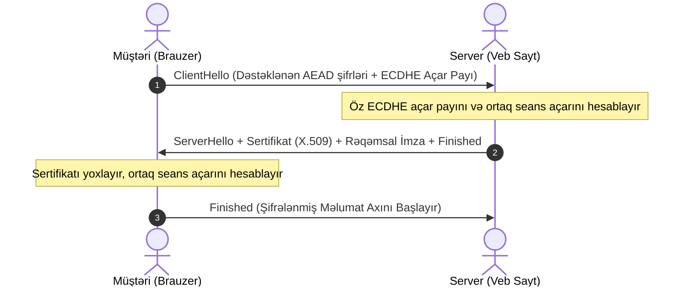

# TLS 1.3 Protokolu (RFC 8446)

**TLS 1.3** — 2018-ci ildə IETF tərəfindən qəbul edilmiş, İnternet üzərində (HTTPS, e-poçt, API) rabitə təhlükəsizliyini təmin edən qlobal şifrələmə protokolunun ən müasir və təhlükəsiz versiyasıdır.

---

## ⚡ TLS 1.2 və TLS 1.3 Müqayisəsi

```mermaid
graph TD
    subgraph TLS 1.2 (Köhnəlmiş)
        A1["2-RTT Handshake Gecikməsi"]
        A2["Statik RSA Açar Mübadiləsi (PFS Yoxdur)"]
        A3["Zəif Şifrlər: RC4, 3DES, CBC-MAC, SHA-1"]
    end
    subgraph TLS 1.3 (Müasir Standart)
        B1["1-RTT Handshake (və 0-RTT Resumption)"]
        B2["Məcburi Ephemeral Diffie-Hellman (PFS)"]
        B3["Yalnız AEAD: AES-GCM, ChaCha20-Poly1305"]
    end
```

---

## 🔒 1-RTT Handshake Axını



- **Mükəmməl İrəli Məxfilik (Perfect Forward Secrecy - PFS):** Hər seans üçün müvəqqəti (ephemeral) ECDHE açarları istifadə olunduğundan, hətta gələcəkdə serverin əsas gizli açarı sızsa belə, keçmişdə qeydə alınmış trafik açıla bilməz.

---

## 🔗 Əlaqəli Səhifələr

- [[İctimai Açar İnfrastrukturu (PKI və X.509)]]
- [[Diffie-Hellman Açar Mübadiləsi]]
- [[Blok Şifrə Rejimləri (ECB, CBC, CTR, GCM)]]
- [[Poly1305 və AEAD]]
- [[Simmetrik və Asimmetrik Kriptoqrafiya]]
