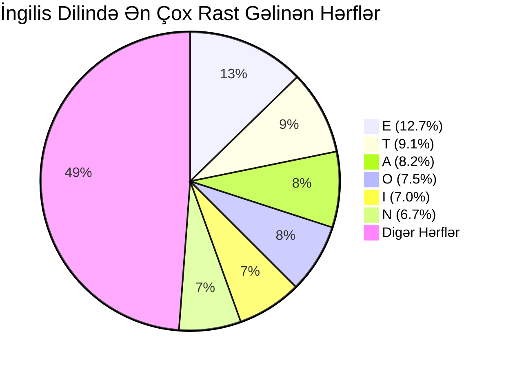

# Tezlik Analizi (Frequency Analysis)

**Tezlik analizi** — təbii dillərdə hərflərin, hərf cütlərinin (diqramlar) və üçlüklərinin (triqramlar) qeyri-bərabər paylanması xüsusiyyətinə əsaslanan klassik kriptoanaliz metodudur.

İlk dəfə IX əsrdə Bağdadda ərəb riyaziyyatçısı və filosofu [[Al-Kindi]] tərəfindən yazılmış *"Kriptoqrafik Mesajların Deşifrə Edilməsi Haqqında Əlyazma"* əsərində sistemləşdirilmişdir.

---

## 📊 İngilis Dilində Hərf Tezlikləri

İngilis dilindəki mətnlərdə hərflərin tipik rastgəlmə faizləri:

- **Ən çox işlənən tək hərflər:** `E` (12.7%), `T` (9.1%), `A` (8.2%), `O` (7.5%), `I` (7.0%), `N` (6.7%), `S` (6.3%), `H` (6.1%), `R` (6.0%).
- **Ən az işlənən hərflər:** `Z` (0.07%), `Q` (0.10%), `X` (0.15%), `J` (0.15%), `K` (0.77%).
- **Ən çox işlənən diqramlar:** `TH`, `HE`, `IN`, `ER`, `AN`, `RE`, `ED`, `ON`, `ES`, `ST`.
- **Ən çox işlənən triqramlar:** `THE`, `AND`, `THA`, `ENT`, `ION`, `TIO`, `FOR`, `NDE`, `HAS`, `NCE`.

---

## 🛠️ Tezlik Analizinin Addımları

1. Şifrəli mətndəki bütün hərflərin sayı və faizləri hesablanır.
2. Ən yüksək tezlikli şifrə hərfləri dildəki ən yüksək tezlikli hərflərlə (`E`, `T`, `A`, `O`) müqayisə edilir.
3. Tək hərfli sözlər (`a`, `I`), iki hərfli sözlər (`of`, `to`, `in`, `is`, `it`) və təkrarlanan hərf cütləri (`ll`, `ee`, `ss`, `oo`) aşkar edilərək fərziyyələr təsdiqlənir.
4. Məlum söz kökləri tapıldıqca bütün əvəzetmə cədvəli addım-addım bərpa olunur.

---

## 🛡️ Tezlik Analizindən Qorunma Yolları

Klassik kriptoqrafiyada tezlik analizini zərərsizləşdirmək üçün sonradan yeni yanaşmalar yaradıldı:
- **Poliəlifbalı Şifrlər (Polyalphabetic Ciphers):** Vigenère şifrəsi kimi sistemlərdə eyni açıq hərf mətnin yerindən asılı olaraq fərqli şifrəli hərflərə çevrilir.
- **Homonimik Şifrələmə:** Tez-tez rast gəlinən `E` hərfi üçün bir neçə fərqli şifrə simvolu təyin edilir ki, onların tezliyi düzlənsin.
- **Müasir Blok Şifrələri:** [[Claude Shannon|Şennonun]] **Diffuziya və Konfuziya (Diffusion & Confusion)** prinsipləri tətbiq olunaraq çıxışdakı hər bir bit girişin bütün bitlərindən asılı edilir (bax: AES).

---

## 🔗 Əlaqəli Səhifələr

- [[Al-Kindi]]
- [[Monoalfabetik Əvəzetmə Şifrələri]]
- [[Sezar Şifrəsi]]
- [[Affin Şifrəsi]]
- [[Claude Shannon]]
- [[Klassik Şifrələrin Təhlükəsizlik Zəiflikləri və Müasir Kriptoqrafiyaya Keçid]]
