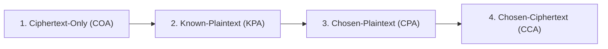

# Təhdid Modelləri (Threat Models)

Kriptoqrafik təhlükəsizlik analizində hücumçunun (adversary / attacker) malik olduğu imkanlar, resurslar və əldə edə biləcəyi məlumatlar **Təhdid Modeli** kimi formalaşdırılır.

---

## 🎭 Kriptoqrafik Personajlar (Standart Konvensiya)

- **Alis (Alice) və Bob:** Qanuni ünsiyyət quran, təhlükəsiz kanal yaratmaq istəyən tərəflər.
- **Eva (Eve - Eavesdropper):** Passiv hücumçu. Kanaldan keçən məlumatları yalnız dinləyir, dəyişdirmir.
- **Mallori (Mallory - Malicious Active Attacker):** Aktiv hücumçu. Mesajları ələ keçirir, silir, saxtalaşdırır və ya yeni mesajlar inyeksiya edir.

---

## 🏹 Kriptoanalitik Hücum Səviyyələri

Hücumçunun əlində olan məlumatın həcminə və sistemlə qarşılıqlı əlaqə dərəcəsinə görə 4 standart təhdid modeli mövcuddur (zəifdən güclüyə doğru):

### 1. Ciphertext-Only Attack (COA - Yalnız Şifrəli Mətn Hücumu)

- **İmkan:** Hücumçunun əlində yalnız bir və ya bir neçə şifrəli mətn ($c_1, c_2, \dots$) var.
- **Məqsəd:** Açıq mətni və ya gizli açarı tapmaq.
- **Tətbiq:** [[Tezlik Analizi]] klassik [[Monoalfabetik Əvəzetmə Şifrələri]] və [[Sezar Şifrəsi]] üzərində COA şəraitində işləyir.

### 2. Known-Plaintext Attack (KPA - Məlum Açıq Mətn Hücumu)

- **İmkan:** Hücumçunun əlində bəzi açıq mətn və onlara uyğun şifrəli mətn cütləri var: $\{(m_1, c_1), (m_2, c_2), \dots\}$.
- **Tətbiq:** [[Affin Şifrəsi]] cəmi 2 hərf cütü ($m_1 \to c_1, m_2 \to c_2$) məlum olduqda KPA hücumu ilə dərhal sındırılır.

### 3. Chosen-Plaintext Attack (CPA - Seçilmiş Açıq Mətn Hücumu)

- **İmkan:** Hücumçu istədiyi açıq mətni ($m_i$) seçib şifrləmə orakuluna (qara qutuya) göndərə və ona uyğun $c_i = E_k(m_i)$ şifrəsini əldə edə bilir.
- **Asimmetrik sistemlərdə:** Bütün asimmetrik şifrələr avtomatik olaraq CPA modelindədir, çünki açıq açar ($pk$) hər kəsə məlumdur və hər kəs istədiyi mətni şifrələyə bilər.

### 4. Chosen-Ciphertext Attack (CCA - Seçilmiş Şifrəli Mətn Hücumu)

- **İmkan:** Hücumçu istədiyi şifrəli mətni ($c_j$) seçib deşifrləmə orakuluna göndərə və ona uyğun $m_j = D_k(c_j)$ açıq mətnini ala bilir (hədəf şifrəli mətn istisna olmaqla).
- **Müasir Tələb:** Müasir etibarlı kriptoqrafik primitivlər IND-CCA2 (Adaptive Chosen-Ciphertext Attack qarşısında fərqləndirilməzlik) səviyyəsində təhlükəsiz olmalıdır.

---

## 🔗 Əlaqəli Səhifələr

- [[Kriptoqrafik Təhlükəsizlik Xidmətləri]]
- [[Kerckhoffs Prinsipi]]
- [[Sezar Şifrəsi]]
- [[Affin Şifrəsi]]
- [[Tezlik Analizi]]
