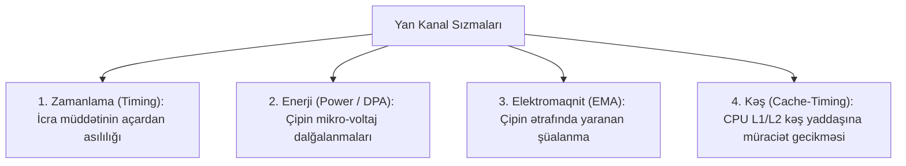

# Yan Kanal Hücumları (Side-Channel Attacks - SCA)

**Yan Kanal Hücumu (SCA)** — kriptoqrafik alqoritmin riyazi zəifliklərinə deyil, onun **fiziki mühitdəki icrası zamanı yaranan fiziki sızmalara** əsaslanan hücum növüdür.

---

## 🔍 Əsas Yan Kanal Növləri

1. **Zamanlama Hücumları (Timing Attacks):** Proqramda şərtli budaqlanma (`if (secret_byte == guess)`) olduqda, fərqli açar baytları fərqli vaxtda icra olunur.
2. **Diferensial Güc Analizi (DPA - Differential Power Analysis):** Paul Kocher tərəfindən kəşf edilmişdir. Çipin tranzistorlarının `0 $\to$ 1` keçidlərində sərf etdiyi mikro-amper fərqləri statistik olaraq gizli açarı aşkar edir.
3. **Kəş Gecikmələri (Spectre / Meltdown / Flush+Reload):** Cədvəl əsaslı AES S-Box axtarışlarında kəş gecikməsi açar baytlarını sızdırır.

---

## 🛡️ Müdafiə Strategiyaları

- **Sabit Zamanlı Proqramlaşdırma (Constant-Time Code):** Məxfi açardan asılı heç bir `if` şərti və ya massiv indeksi istifadə edilmir (məsələn, [[Trivium və ChaCha20|ChaCha20]] və Curve25519 dizaynı).
- **Maskalama (Masking / Blinding):** RSA və AES əməliyyatlarında daxili dəyərlər təsadüfi maskalarla örtülür və əməliyyatın sonunda maska ləğv edilir.

---

## 🔗 Əlaqəli Səhifələr

- [[Trivium və ChaCha20]]
- [[AES Alqoritmi (Rijndael)]]
- [[RSA Kriptosistemi]]
- [[Təhdid Modelləri]]
- [[EMV Standartı]]
