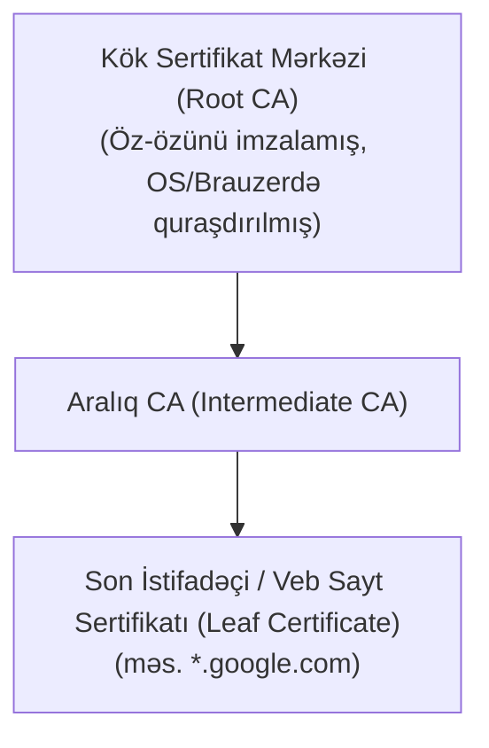

# İctimai Açar İnfrastrukturu (PKI və X.509)

**İctimai Açar İnfrastrukturu (PKI - Public Key Infrastructure)** — rəqəmsal sertifikatların yaradılması, paylanması, idarə edilməsi və ləğv edilməsi üçün rol, siyasət, aparat və proqram təminatı toplusudur.

Onun əsas məqsədi **Ortadakı Adam (Man-in-the-Middle - MitM)** hücumlarının qarşısını almaq və açıq açarın həqiqətən iddia edilən ünvana (məsələn, `google.com`) məxsus olduğunu təsdiqləməkdir.

---

## 🏛️ Əsas Komponentlər və Zəncirvari Etibar (Chain of Trust)

- **Sertifikat Mərkəzi (Certificate Authority - CA):** Rəqəmsal sertifikatları imzalayan etibarlı təşkilat (məs. Let's Encrypt, DigiCert).
- **X.509 Standartı:** Sertifikatın formatını müəyyən edir (Sahibin adı, Açıq açar, Etibarlılıq müddəti, CA-nın rəqəmsal imzası).

---

## 🛑 Sertifikatın Ləğvi (Revocation)

1. **CRL (Certificate Revocation List):** CA tərəfindən vaxtaşırı dərc olunan ləğv edilmiş sertifikatlar siyahısı (yavaş və böyük həcmlidir).
2. **OCSP (Online Certificate Status Protocol):** Brauzerin real vaxtda CA-dan sertifikatın statusunu soruşması.
3. **OCSP Stapling:** Veb-serverin özünün CA-dan imzalı OCSP statusunu alıb TLS əlaqəsi zamanı müştəriyə təqdim etməsi (məxfilik və sürət baxımından ən yaxşı standart).

---

## 🔗 Əlaqəli Səhifələr

- [[TLS 1.3 Protokolu]]
- [[Rəqəmsal İmzalar və ECDSA]]
- [[Simmetrik və Asimmetrik Kriptoqrafiya]]
- [[PGP və S-MIME]]
