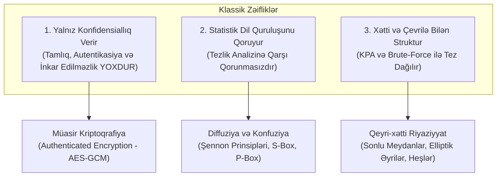

# Klassik Şifrələrin Təhlükəsizlik Zəiflikləri və Müasir Kriptoqrafiyaya Keçid

Bu sintez mühazirə 1 və mühazirə 2 materiallarını birləşdirərək klassik monoalfabetik şifrələrin niyə müasir dünyada yararsız olduğunu və müasir kriptoqrafik arxitekturaların bu boşluqları necə bağladığını təhlil edir.

---

## 1. Klassik Şifrələrin 3 Fundamental Çatışmazlığı

### A. Təhlükəsizlik Xidmətlərinin Çatışmazlığı

Bax: [[Kriptoqrafik Təhlükəsizlik Xidmətləri]]
- [[Sezar Şifrəsi]], [[Affin Şifrəsi]] və [[Monoalfabetik Əvəzetmə Şifrələri]] yalnız açıq mətni gizlətməyə (konfidensiallıq) çalışır.
- Əgər aktiv hücumçu (Mallori) şifrəli mətndəki hərfləri dəyişdirərsə, alıcı bunu heç cür təsbit edə bilməz (tamlıq yoxdur).
- Saxta mesaj yaratmaq üçün heç bir açar təsdiqi yoxdur (autentikasiya yoxdur).
- Göndərən mesajı yazdığını asanlıqla inkar edə bilər (inkar edilməzlik yoxdur).

### B. Dil Statistikasının Qorunması (Tezlik Zəifliyi)

Bax: [[Tezlik Analizi]]
- Açar fəzası hətta $26! \approx 4 \times 10^{26}$ olsa belə, hər bir `E` hərfini həmişə eyni `X` hərfinə çevirən deterministik qayda təbii dildəki informasiya entropiyasını və tezlik paylanmasını məhv edə bilmir.
- [[Al-Kindi]] metodikası sübut etdi ki, deterministik tək-hərf əvəzetmələri nəzəri cəhətdən sıfır şifrələmə gücünə malikdir.

### C. Riyazi Zəifliklər və Kiçik Açar Fəzası

Bax: [[Modul Arifmetika]]
- Sezarda cəmi 25, Affində isə 312 açar var.
- Affin şifrəsində xəttilik səbəbindən [[Təhdid Modelləri|Məlum Açıq Mətn Hücumu (KPA)]] cəmi 2 hərf cütü ilə açarı dərhal bərpa edir.

---

## 2. Müasir Kriptoqrafiyaya Keçid Tələbləri

| Xüsusiyyət | Klassik Şifrlər | Müasir Blok / Axın Şifrləri (AES, ChaCha20) |
| :--- | :--- | :--- |
| **İş vahidi** | Hərflər / Simvollar | Bitlər / Baytlar / Bloklar (128-bit) |
| **Dizayn fəlsəfəsi** | Gizli qalmağa güvənən sadə qaydalar | [[Kerckhoffs Prinsipi]] və [[Claude Shannon\|Şennon]] prinsipləri |
| **Struktur** | Xətti əvəzetmə / yerdəyişmə | Qeyri-xətti S-Box + Qarışdırma qatları (SPN) |
| **Statistik paylanma** | Mətnin tezlik profilini təkrarlayır | Çıxış tam təsadüfi səs-küyə (ağ səs-küy) bənzəyir |
| **Açar fəzası** | $26$ - $26!$ | $2^{128}$ - $2^{256}$ |
| **Bütövlük və Autentikasiya** | Yoxdur | AEAD (Authenticated Encryption with Associated Data) |

---

## 3. Nəticə

Klassik şifrlər müasir kommunikasiyanı qorumaq üçün tamamilə yararsız olsa da, onlar:
1. Kriptoqrafik təfəkkürün və [[Kriptosistem Beşliyi|riyazi modelləşdirmənin]] təməlini qoyur;
2. Kriptoanalizin ([[Tezlik Analizi]]) gücünü və zəruriliyini nümayiş etdirir;
3. Müasir asimmetrik və simmetrik sistemlərin niyə qeyri-xətti riyaziyyata ([[Modul Arifmetika]], sonlu meydanlar, elliptik əyrilər) ehtiyac duyduğunu əyani şəkildə izah edir.

---

## 🔗 Əlaqəli Səhifələr

- [[Kriptoqrafik Təhlükəsizlik Xidmətləri]]
- [[Kerckhoffs Prinsipi]]
- [[Simmetrik və Asimmetrik Kriptoqrafiya]]
- [[Tezlik Analizi]]
- [[Sezar Şifrəsi]]
- [[Affin Şifrəsi]]
- [[Monoalfabetik Əvəzetmə Şifrələri]]
- [[Summary - Mühazirə 1 (Kriptoqrafiyaya Giriş)]]
- [[Summary - Mühazirə 2 (Klassik Şifrələr və Modul Arifmetika)]]
