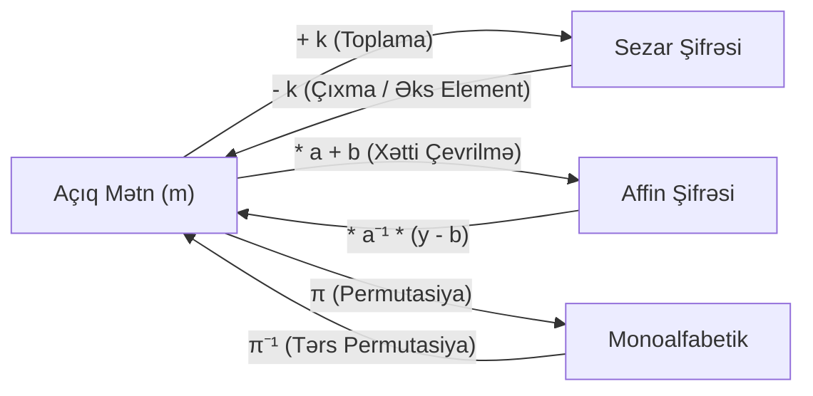

# Kriptoqrafiyada Riyazi İnversiya və Açar Məkanının Təhlili

Bu sintez mühazirə 1 və 2-nin riyazi aparatını sistemləşdirərək, kriptoqrafiyada **deşifrləmənin inversiya mexanizmini**, **qarşılıqlı sadəliyin rolunu** və **açar məkanının formal ölçülərini** müqayisəli şəkildə araşdırır.

---

## 1. Deşifrləmənin Riyazi Təbiəti: Əks Əməliyyatlar və İnversiya

Kriptoqrafiyada hər bir $E_k$ şifrləmə çevrilməsinin $D_k$ deşifrləməsi riyazi olaraq müvafiq cəbri strukturda **əks elementin (inversiyanın)** tapılmasına əsaslanır:

### İnversiya Mexanizmlərinin İerarxiyası:

1. **Additiv İnversiya (Toplama Qrupu $\mathbb{Z}_m(+)$):**
   - [[Sezar Şifrəsi]] $x \mapsto x + k \bmod m$.
   - Tərs əməliyyat: $y \mapsto y - k \equiv y + (m - k) \pmod m$. Hər bir $k \in \mathbb{Z}_m$ üçün additiv tərs həmişə mövcuddur.
2. **Multiplikativ İnversiya (Vurma Qrupu $\mathbb{Z}_m^*(\times)$):**
   - [[Affin Şifrəsi]] $x \mapsto a \cdot x + b \bmod m$.
   - Tərs əməliyyat üçün mütləq $a \cdot a^{-1} \equiv 1 \pmod m$ ödənməlidir.
   - Bu isə yalnız və yalnız $\gcd(a, m) = 1$ olduqda mümkündür və [[Genişləndirilmiş Evklid Alqoritmi]] ilə hesablanır.
3. **Kombinator İnversiya (Simmetrik Qrup $S_{26}$):**
   - [[Monoalfabetik Əvəzetmə Şifrələri]] $x \mapsto \pi(x)$.
   - Tərs əməliyyat: $y \mapsto \pi^{-1}(y)$.

---

## 2. Açar Məkanının Təkamülü və Təhlükəsizlik Sərhədləri

Kriptosistemin təhlükəsizliyinin ilk şərti onun açar məkanının $|\mathcal{K}|$ tam axtarışa (brute-force) qarşı davamlı olmasıdır:

| Kriptosistem | Açar Fəzası Formulu | Ədədi Qiymət | Bit Ekvivalenti | Brute-Force ilə Sındırılma Müddəti |
| :--- | :--- | :--- | :--- | :--- |
| **[[Sezar Şifrəsi]]** | $m$ ($m=26$) | $26$ | $\approx 4.7 \text{ bit}$ | < 1 millisaniyə |
| **[[Affin Şifrəsi]]** | $\phi(m) \times m$ | $12 \times 26 = 312$ | $\approx 8.3 \text{ bit}$ | < 1 millisaniyə |
| **[[Poliəlifbalı Əvəzetmə Şifrələri\|Vigenère ($d=5$)]]** | $26^5$ | $11,881,376$ | $\approx 23.5 \text{ bit}$ | < 1 saniyə |
| **[[Monoalfabetik Əvəzetmə Şifrələri]]** | $26!$ | $\approx 4.03 \times 10^{26}$ | $\approx 88.4 \text{ bit}$ | Praktik olaraq qeyri-mümkün (lakin tezlik analizi ilə dərhal sındırılır) |
| **DES (Köhnə Standart)** | $2^{56}$ | $\approx 7.2 \times 10^{16}$ | $56 \text{ bit}$ | Bir neçə saat (ASIC ilə) |
| **Müasir AES-128** | $2^{128}$ | $\approx 3.4 \times 10^{38}$ | $128 \text{ bit}$ | Kainatın yaşından çox |
| **Müasir AES-256 / [[Bitcoin\|Bitcoin Secp256k1]]** | $2^{256}$ | $\approx 1.15 \times 10^{77}$ | $256 \text{ bit}$ | Mümkün deyil |

---

## 3. Açar Ölçüsü $\ne$ Təhlükəsizlik Aksiomu

Riyazi analiz göstərir ki, böyük açar fəzası zəruri şərtdir, lakin kafi deyil:
- Monoalfabetik şifrə $2^{88}$ açara malik olmasına baxmayaraq, xətti inikas və invariant hərf tezliyi səbəbilə [[Tezlik Analizi]] qarşısında tamamilə çökür.
- Əsl təhlükəsizlik yalnız [[Claude Shannon|Şennonun]] **Konfuziya və Diffuziya** prinsiplərini qeyri-xətti riyazi çevrilmələrlə birləşdirən sistemlərdə (məs. SPN şəbəkələri, AES, SHA-256) əldə edilir.

---

## 🔗 Əlaqəli Səhifələr

- [[Modul Arifmetika]]
- [[Genişləndirilmiş Evklid Alqoritmi]]
- [[Kriptosistem Beşliyi]]
- [[Sezar Şifrəsi]]
- [[Affin Şifrəsi]]
- [[Monoalfabetik Əvəzetmə Şifrələri]]
- [[Poliəlifbalı Əvəzetmə Şifrələri]]
- [[Tezlik Analizi]]
- [[Claude Shannon]]
- [[Klassik Şifrələrin Təhlükəsizlik Zəiflikləri və Müasir Kriptoqrafiyaya Keçid]]
