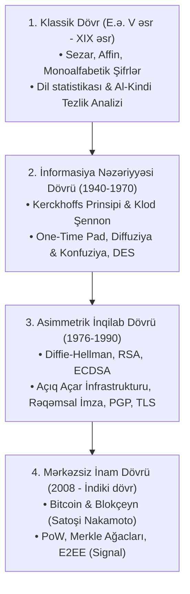

# Kriptoqrafiyanın Təkamülü: Klassik Əvəzetmədən Asimmetrik və Blokçeyn İnframodelinə

Bu sintez bəşəriyyətin 2500 illik kriptoqrafik inkişaf xəritəsini dörd böyük paradiqma dövrü üzrə ümumiləşdirir.

---

## 🗺️ Təkamül Xəritəsi (Dörd Əsr)

---

## 🏛️ Dörd Dövrün Müqayisəli Xarakteristikası

| Dövr | Əsas Kriptoqrafik Problem | Həll Mexanizmi | Tipik Zəiflik / Nöqsan | Əsas Fiqurlar |
| :--- | :--- | :--- | :--- | :--- |
| **Klassik Dövr** | Hərbi məktubların gizlənməsi | Sadə əvəzetmə və yerdəyişmə | [[Tezlik Analizi]], kiçik açar fəzası | [[Julius Caesar]], [[Al-Kindi]] |
| **Şennon Dövrü** | Riyazi model və mütləq gizlilik | [[One-Time Pad və Mükəmməl Gizlilik\|One-Time Pad]], SPN blok şifrləri | Açar paylanması problemi ($O(n^2)$) | [[Auguste Kerckhoffs]], [[Claude Shannon]], [[Gilbert Vernam]] |
| **Açıq Açar Dövrü** | Təhlükəsiz kanalsız açar mübadiləsi | Diskret loqarifm, faktorizasiya, [[Diffie-Hellman Açar Mübadiləsi\|Diffie-Hellman]], [[Rəqəmsal İmzalar və ECDSA\|ECDSA]] | Hesablama mürəkkəbliyi (yavaşlıq), CA asılılığı | [[Whitfield Diffie və Martin Hellman]] |
| **Blokçeyn Dövrü** | Mərkəzsiz inam və ikiqat xərcləmə | [[Bitcoin]], [[Kriptoqrafik Heş Funksiyaları\|SHA-256]], [[Merkle Ağacları]], Proof of Work | Miqyaslanma və enerji sərfiyyatı | [[Satoshi Nakamoto]], [[Adam Back]] |

---

## 💡 Əsas Nəticə və Fəlsəfə

1. **Gizlilik Təhlükəsizlik Demək Deyil:** Ən qədim dövrdən bəri alqoritmi gizlətmək prinsipi hər zaman çökmüşdür. Yalnız riyazi cəhətdən isbat olunan və ictimai sınaqlardan keçən sistemlər etibarlıdır ([[Kerckhoffs Prinsipi]]).
2. **Kriptoqrafiya Yalnız Şifrləmə Deyil:** Müasir rəqəmsal cəmiyyət üçün konfidensiallıqdan daha çox **tamlıq**, **autentikasiya** və **inkarolunmazlıq** tələb olunur ([[Kriptoqrafik Təhlükəsizlik Xidmətləri]]).
3. **Kombinator Güc:** Blokçeyn və E2EE texnologiyaları heç bir "yeni riyazi möcüzə" yaratmamış, sadəcə keçmiş 50 ilin ən güclü riyazi ixtiralarını (Heşlər + Rəqəmsal İmzalar + P2P Şəbəkələr) optimal şəkildə birləşdirmişdir.

---

## 🔗 Əlaqəli Səhifələr

- [[Kerckhoffs Prinsipi]]
- [[Claude Shannon]]
- [[Diffie-Hellman Açar Mübadiləsi]]
- [[Rəqəmsal İmzalar və ECDSA]]
- [[Bitcoin]]
- [[Satoshi Nakamoto]]
- [[Merkle Ağacları]]
- [[Klassik Şifrələrin Təhlükəsizlik Zəiflikləri və Müasir Kriptoqrafiyaya Keçid]]
- [[Kriptoqrafiyada Riyazi İnversiya və Açar Məkanının Təhlili]]
