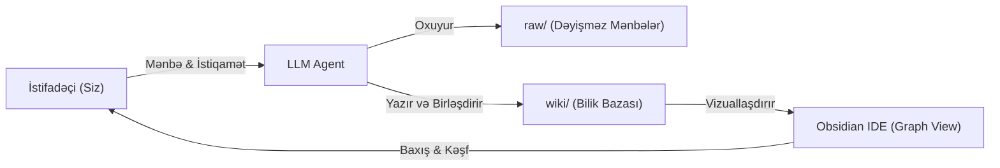

# LLM Wiki və Obsidian İstifadə Bələdçisi

Bu sənəd **LLM Wiki Pattern** konsepsiyasının Obsidian mühitində necə işlədiyini, onun ənənəvi qeyd götürmə və RAG metodlarından fərqini və gündəlik istifadə qaydalarını izah edir.

---

## 🏛️ LLM Wiki-nin Əsas Fəlsəfəsi

Klassik qeyd sistemlərində ən böyük maneə biliklərin daimi qeydiyyatı və yenilənməsi yükünün (bookkeeping) insan üzərində olmasıdır. Nəticədə vaxt keçdikcə vikilər tərk edilir.

LLM Wiki modelində rollar tamamilə bölünür:
- **İnsan:** Mənbələri seçir (curation), istiqaməti müəyyən edir və strateji suallar verir.
- **LLM Agent:** Oxuyur, xülasə edir, atomar səhifələr yaradır, çarpaz keçidləri (`[[WikiLink]]`) bağlayır, ziddiyyətləri qeyd edir və kataloqu saxlayır.
- **Obsidian:** Canlı interfeys və qrafik vizuallaşdırma mühitidir.

---

## 🧭 Obsidian-da Ən Səmərəli İstifadə Yolları

### 1. Qrafik Görünüşü (Graph View - `Ctrl/Cmd + G`)

- Repozitoriyanı Obsidian-da açdıqda sol paneldən və ya qısayolla Graph View-a daxil olun.
- Mərkəzi mövzuları (məsələn, [[Kerckhoffs Prinsipi]], [[Modul Arifmetika]], [[Bitcoin]], [[Claude Shannon]]) böyük düyünlər kimi görəcəksiniz.
- Qonşu anlayışlar arasındakı xətləri izləyərək bilikləri assosiativ şəkildə kəşf edin.

### 2. Canlı Önizləmə və Keçidlərin İzlənməsi

- İstənilən `[[Anlayış]]` üzərinə klikləyərək dərhal həmin mövzuya keçin.
- Hər səhifənin sonunda yerləşən `## 🔗 Əlaqəli Səhifələr` bloku və sağ tərəfdəki *Backlinks* paneli mövzunun bütün kontekstlərini göstərir.

### 3. Gündəlik İş Axınları (Workflows)

1. **İnqest (`ingest`):** Yeni bir məqalə, ağ sənəd və ya dərslik tapdıqda onu `raw/` qovluğuna qoyub agentə bildirin. Agent bütün vikini həmin mənbə ilə zənginləşdirəcək.
2. **Sorğu və Sintez (`query`):** Agentdən iki anlayış arasındakı fərqi və ya praktiki bir tətbiqi soruşun. Cavab həm sizə təqdim olunacaq, həm də `wiki/syntheses/` qovluğuna yeni bir bilik səhifəsi kimi əlavə ediləcək.
3. **Lint (`lint`):** Vaxtaşırı agentə bütövlük yoxlanışı etdirin.

---

## 🔗 Əlaqəli Səhifələr

- [[AGENTS.md]]
- [[index.md]]
- [[log.md]]
- [[Kriptoqrafiyanın Təkamülü: Klassik Əvəzetmədən Asimmetrik və Blokçeyn İnframodelinə]]
- [[Klassik Şifrələrin Təhlükəsizlik Zəiflikləri və Müasir Kriptoqrafiyaya Keçid]]
